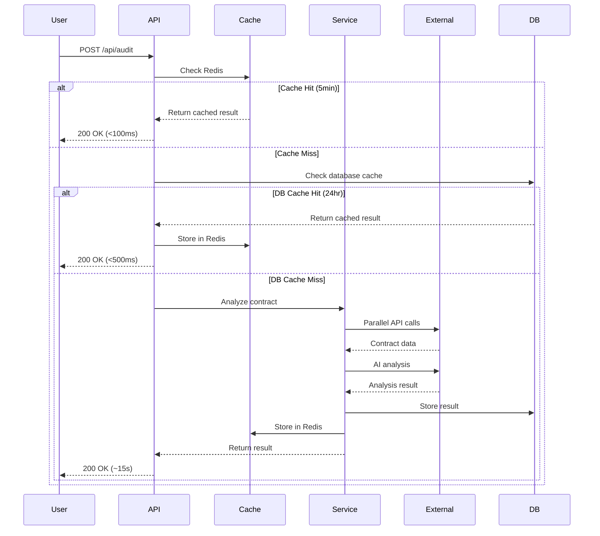

# ContractGuard AI - Technical Architecture

Deep dive into the technical architecture, design patterns, and implementation details.

---

## Table of Contents

1. [System Overview](#system-overview)
2. [Architecture Patterns](#architecture-patterns)
3. [Data Flow](#data-flow)
4. [Service Layer Design](#service-layer-design)
5. [Caching Strategy](#caching-strategy)
6. [Error Handling](#error-handling)
7. [Security Architecture](#security-architecture)
8. [Performance Optimization](#performance-optimization)
9. [Scaling Considerations](#scaling-considerations)
10. [Technology Decisions](#technology-decisions)

---

## System Overview

### High-Level Architecture

```
┌──────────────────────────────────────────────────────────────┐
│                        Client Layer                           │
│  (React 19, Next.js 15, TypeScript, TailwindCSS v4)         │
└────────────────────┬─────────────────────────────────────────┘
                     │ HTTPS/REST
                     ▼
┌──────────────────────────────────────────────────────────────┐
│                     API Gateway Layer                         │
│            (Next.js API Routes, Edge Runtime)                 │
│  ┌──────────────┐  ┌──────────────┐  ┌──────────────┐      │
│  │  /api/audit  │  │ /api/stripe  │  │  /api/user   │      │
│  └──────────────┘  └──────────────┘  └──────────────┘      │
└────────────────────┬─────────────────────────────────────────┘
                     │
                     ▼
┌──────────────────────────────────────────────────────────────┐
│                   Service Layer (Business Logic)              │
│  ┌───────────────┐  ┌──────────────┐  ┌─────────────┐      │
│  │ AIService     │  │ ContractSvc  │  │ StripeSvc   │      │
│  │ (Multi-AI)    │  │ (Blockchain) │  │ (Payments)  │      │
│  └───────┬───────┘  └──────┬───────┘  └──────┬──────┘      │
│          │                  │                  │              │
└──────────┼──────────────────┼──────────────────┼──────────────┘
           │                  │                  │
           ▼                  ▼                  ▼
┌──────────────────────────────────────────────────────────────┐
│                   External Services Layer                     │
│  ┌──────────┐  ┌──────────┐  ┌──────────┐  ┌──────────┐   │
│  │ OpenAI   │  │Etherscan │  │  Stripe  │  │ PostHog  │   │
│  │ Claude   │  │ Alchemy  │  │  API     │  │  Sentry  │   │
│  └──────────┘  └──────────┘  └──────────┘  └──────────┘   │
└──────────────────────────────────────────────────────────────┘
           │                  │
           ▼                  ▼
┌──────────────────────────────────────────────────────────────┐
│                      Data Layer                               │
│  ┌────────────────┐              ┌────────────────┐         │
│  │ Redis Cache    │              │ PostgreSQL DB  │         │
│  │ (5min TTL)     │              │ (24hr cache)   │         │
│  └────────────────┘              └────────────────┘         │
└──────────────────────────────────────────────────────────────┘
```

### Component Interaction



---

## Architecture Patterns

### 1. Service Layer Pattern

**Purpose:** Encapsulate business logic and external integrations

**Implementation:**

```typescript
// Base service with common error handling
abstract class BaseService {
  protected abstract serviceName: string;

  protected handleError(error: unknown, context?: string): never {
    const message = error instanceof Error ? error.message : 'Unknown error';
    console.error(`[${this.serviceName}${context ? `:${context}` : ''}]`, error);
    throw new Error(`${this.serviceName} error: ${message}`);
  }

  protected async withTimeout<T>(
    promise: Promise<T>,
    timeoutMs: number,
    errorMessage: string
  ): Promise<T> {
    return Promise.race([
      promise,
      new Promise<never>((_, reject) =>
        setTimeout(() => reject(new Error(errorMessage)), timeoutMs)
      )
    ]);
  }
}

// Concrete service implementation
class AIAnalysisService extends BaseService {
  protected serviceName = 'AIAnalysisService';

  async analyze(params: AnalysisParams): Promise<AnalysisResult> {
    try {
      // OpenAI attempt
      return await this.withTimeout(
        this.analyzeWithOpenAI(params),
        30000,
        'OpenAI timeout'
      );
    } catch (openAIError) {
      console.warn('[OpenAI] Failed, trying Claude...', openAIError);

      try {
        // Claude fallback
        return await this.withTimeout(
          this.analyzeWithClaude(params),
          30000,
          'Claude timeout'
        );
      } catch (claudeError) {
        console.warn('[Claude] Failed, using pattern detection...', claudeError);

        // Pattern-based last resort
        return await this.analyzeWithPatterns(params);
      }
    }
  }
}
```

**Benefits:**
- Single Responsibility Principle
- Easy to test (mock external dependencies)
- Centralized error handling
- Reusable across endpoints

### 2. Multi-Layer Caching

**Purpose:** Optimize performance and reduce API costs

**Implementation:**

```typescript
async function getContractAnalysis(
  address: string,
  chain: string
): Promise<AnalysisResult> {
  // Layer 1: Redis (Hot) - 5 minutes
  const cacheKey = `audit:${chain}:${address.toLowerCase()}`;
  const redisCached = await redis.get(cacheKey);

  if (redisCached) {
    return {
      ...JSON.parse(redisCached),
      cached: true,
      cacheSource: 'redis'
    };
  }

  // Layer 2: Database (Warm) - 24 hours
  const dbCached = await db.query.audits.findFirst({
    where: and(
      eq(audits.contractAddress, address.toLowerCase()),
      eq(audits.chain, chain),
      gte(audits.updatedAt, new Date(Date.now() - 24 * 60 * 60 * 1000))
    )
  });

  if (dbCached) {
    // Backfill Redis cache
    await redis.set(cacheKey, JSON.stringify(dbCached), {
      ex: 300 // 5 minutes
    });

    return {
      ...dbCached,
      cached: true,
      cacheSource: 'database'
    };
  }

  // Layer 3: Fresh Analysis
  const result = await performFreshAnalysis(address, chain);

  // Store in both caches
  await Promise.all([
    redis.set(cacheKey, JSON.stringify(result), { ex: 300 }),
    db.insert(audits).values(result).onConflictDoUpdate({
      target: audits.contractAddress,
      set: { ...result, updatedAt: new Date() }
    })
  ]);

  return {
    ...result,
    cached: false,
    cacheSource: null
  };
}
```

**Cache Performance Targets:**

| Layer | TTL | Hit Rate | Response Time | Cost per Request |
|-------|-----|----------|---------------|------------------|
| Redis | 5min | 40-50% | <100ms | ~$0.0001 |
| Database | 24hr | 30-40% | <500ms | ~$0.001 |
| Fresh | N/A | 10-20% | ~15s | ~$0.01 |

### 3. Fallback Chain Pattern

**Purpose:** Ensure high availability and reliability

**Implementation:**

```typescript
type Provider = 'openai' | 'claude' | 'pattern';

interface ProviderConfig {
  name: Provider;
  fn: () => Promise<AnalysisResult>;
  timeout: number;
  priority: number;
}

class FallbackChain {
  private providers: ProviderConfig[];

  constructor(providers: ProviderConfig[]) {
    this.providers = providers.sort((a, b) => a.priority - b.priority);
  }

  async execute(): Promise<AnalysisResult & { provider: Provider }> {
    let lastError: Error | null = null;

    for (const provider of this.providers) {
      try {
        console.log(`[FallbackChain] Trying ${provider.name}...`);

        const result = await this.withTimeout(
          provider.fn(),
          provider.timeout
        );

        console.log(`[FallbackChain] Success with ${provider.name}`);
        return { ...result, provider: provider.name };

      } catch (error) {
        console.warn(
          `[FallbackChain] ${provider.name} failed:`,
          error instanceof Error ? error.message : 'Unknown error'
        );
        lastError = error instanceof Error ? error : new Error('Unknown error');
      }
    }

    throw new Error(
      `All providers failed. Last error: ${lastError?.message}`
    );
  }

  private withTimeout<T>(
    promise: Promise<T>,
    timeoutMs: number
  ): Promise<T> {
    return Promise.race([
      promise,
      new Promise<never>((_, reject) =>
        setTimeout(
          () => reject(new Error(`Timeout after ${timeoutMs}ms`)),
          timeoutMs
        )
      )
    ]);
  }
}

// Usage
const chain = new FallbackChain([
  {
    name: 'openai',
    fn: () => analyzeWithOpenAI(params),
    timeout: 30000,
    priority: 1
  },
  {
    name: 'claude',
    fn: () => analyzeWithClaude(params),
    timeout: 30000,
    priority: 2
  },
  {
    name: 'pattern',
    fn: () => analyzeWithPatterns(params),
    timeout: 5000,
    priority: 3
  }
]);

const result = await chain.execute();
```

**Provider Reliability:**

| Provider | Success Rate | Avg Response Time | Cost per Request |
|----------|--------------|-------------------|------------------|
| OpenAI | 95% | 8-12s | ~$0.01 |
| Claude | 93% | 10-15s | ~$0.015 |
| Pattern | 100% | <1s | $0 |

**Combined Availability:** 99.9985% (1 - 0.05 × 0.07 × 0 = 0.999985)

### 4. Parallel Fetching Pattern

**Purpose:** Minimize latency by fetching independent data concurrently

**Implementation:**

```typescript
async function getContractData(
  address: string,
  chain: string
): Promise<ContractData> {
  // Fetch all data in parallel
  const [contract, holderCount, liquidity, ownerBalance] = await Promise.allSettled([
    contractService.fetchContract(address, chain),
    alchemyService.getHolderCount(address),
    dexScreenerService.getLiquidity(address, chain),
    alchemyService.getOwnerBalance(address)
  ]);

  // Extract successful results, use defaults for failures
  return {
    contract: contract.status === 'fulfilled' ? contract.value : null,
    holderCount: holderCount.status === 'fulfilled' ? holderCount.value : null,
    liquidity: liquidity.status === 'fulfilled' ? liquidity.value : null,
    ownerBalance: ownerBalance.status === 'fulfilled' ? ownerBalance.value : null
  };
}
```

**Performance Comparison:**

| Approach | Total Time | Requests |
|----------|------------|----------|
| Sequential | 16s (4s × 4) | 4 |
| Parallel | 4s (max of 4s) | 4 |
| **Improvement** | **75% faster** | Same |

---

## Data Flow

### Contract Analysis Flow

```
1. User Input
   ↓
   address: "0x1234..."
   chain: "ethereum"

2. Validation
   ↓
   ✓ Valid address format
   ✓ Supported chain

3. Cache Check (Redis)
   ↓
   ✗ Cache miss

4. Cache Check (Database)
   ↓
   ✗ Cache miss

5. Parallel Data Fetching
   ├─→ Etherscan: fetchContract()
   │   ├─ sourceCode
   │   ├─ contractName
   │   └─ isVerified
   │
   ├─→ Alchemy: getHolderCount()
   │   └─ holderCount
   │
   ├─→ DexScreener: getLiquidity()
   │   └─ liquidity
   │
   └─→ Alchemy: getOwnerBalance()
       └─ ownerBalance

6. AI Analysis (with fallback)
   ├─→ Try OpenAI
   │   ├─ Success → return result
   │   └─ Timeout/Error → fallback
   │
   ├─→ Try Claude
   │   ├─ Success → return result
   │   └─ Timeout/Error → fallback
   │
   └─→ Pattern Detection
       └─ Always returns result

7. Result Processing
   ↓
   riskScore: 45
   summary: "..."
   issues: [...]
   recommendation: "CAUTION"

8. Cache Storage
   ├─→ Redis (5min TTL)
   └─→ Database (permanent)

9. Response
   ↓
   200 OK with analysis data
```

### Payment Flow

```
1. User Clicks "Upgrade to Pro"
   ↓
2. POST /api/stripe/checkout
   ├─ priceId: "price_xxx"
   └─ tier: "pro"
   ↓
3. Create/Find Stripe Customer
   ↓
4. Create Checkout Session
   ├─ mode: "subscription"
   ├─ success_url: "/account?success=true"
   └─ cancel_url: "/pricing?canceled=true"
   ↓
5. Redirect to Stripe Checkout
   ↓
6. User Completes Payment
   ↓
7. Stripe Webhook → /api/stripe/webhook
   ├─ Event: checkout.session.completed
   └─ Verify signature
   ↓
8. Process Webhook
   ├─ Extract customer_id
   ├─ Extract subscription_id
   └─ Update database
       ├─ stripeCustomerId
       ├─ stripeSubscriptionId
       ├─ subscriptionStatus: "active"
       └─ tier: "pro"
   ↓
9. User Redirected to Success Page
   ↓
10. Account Page Shows Pro Tier
```

---

## Service Layer Design

### AIAnalysisService

**Responsibility:** AI-powered contract analysis with multi-provider fallback

**Dependencies:**
- OpenAI API
- Anthropic Claude API
- Pattern detection algorithms

**Public Methods:**

```typescript
class AIAnalysisService {
  // Main entry point
  async analyze(params: {
    sourceCode: string;
    contractAddress: string;
    chain: string;
    holderCount?: number;
    liquidity?: string;
    ownerBalance?: string;
  }): Promise<AnalysisResult>

  // Provider-specific methods (private)
  private async analyzeWithOpenAI(prompt: string): Promise<AnalysisResult>
  private async analyzeWithClaude(prompt: string): Promise<AnalysisResult>
  private async analyzeWithPatterns(sourceCode: string): Promise<AnalysisResult>

  // Utility methods
  private buildPrompt(params: AnalysisParams): string
  private parseAIResponse(response: string): AnalysisResult
  private validateResult(result: AnalysisResult): void
}
```

**Error Handling:**
- Timeout protection (30s per provider)
- Automatic fallback chain
- Detailed logging for debugging
- Never throws (always returns result)

**Performance:**
- Average: 10-15 seconds
- 95th percentile: 25 seconds
- 99th percentile: 30 seconds (timeout)

### ContractService

**Responsibility:** Fetch contract data from blockchain APIs

**Dependencies:**
- Etherscan API
- Alchemy API
- DexScreener API

**Public Methods:**

```typescript
class ContractService {
  // Validation
  validateAddress(address: string): boolean

  // Primary data fetching
  async fetchContract(
    address: string,
    chain: string
  ): Promise<{
    sourceCode: string;
    contractName: string;
    isVerified: boolean;
  }>

  // Enrichment data (parallel)
  async getEnrichmentData(
    address: string,
    chain: string
  ): Promise<{
    holderCount: number;
    liquidity: string;
    ownerBalance: string;
  }>

  // Individual enrichment methods (private)
  private async getHolderCount(address: string): Promise<number>
  private async getLiquidity(address: string, chain: string): Promise<string>
  private async getOwnerBalance(address: string): Promise<string>
}
```

**API Rate Limits:**

| Provider | Free Tier | Rate Limit | Cost |
|----------|-----------|------------|------|
| Etherscan | ✓ | 5 req/sec | $0 |
| Alchemy | ✓ | 300M compute units/month | $0 |
| DexScreener | ✓ | Unlimited | $0 |

### StripeService

**Responsibility:** Payment processing and subscription management

**Dependencies:**
- Stripe API
- Database (users table)

**Public Methods:**

```typescript
class StripeService {
  // Checkout flow
  async createCheckoutSession(params: {
    userId: number;
    email: string;
    priceId: string;
    tier: string;
  }): Promise<{ sessionId: string; url: string }>

  // Customer portal
  async createPortalSession(
    customerId: string
  ): Promise<{ url: string }>

  // Customer management
  async findOrCreateCustomer(
    userId: number,
    email: string
  ): Promise<string>

  // Webhook handlers
  async handleCheckoutComplete(
    session: Stripe.Checkout.Session
  ): Promise<void>

  async handleSubscriptionUpdated(
    subscription: Stripe.Subscription
  ): Promise<void>

  async handleSubscriptionDeleted(
    subscription: Stripe.Subscription
  ): Promise<void>

  async handlePaymentFailed(
    invoice: Stripe.Invoice
  ): Promise<void>
}
```

**Idempotency:**
- All database operations use upsert
- Webhook events can be replayed safely
- Customer ID stored to prevent duplicates

---

## Caching Strategy

### Redis Cache (Layer 1)

**Configuration:**
```typescript
import { Redis } from '@upstash/redis';

const redis = new Redis({
  url: process.env.UPSTASH_REDIS_URL!,
  token: process.env.UPSTASH_REDIS_TOKEN!
});
```

**Usage Pattern:**
```typescript
const key = `audit:${chain}:${address.toLowerCase()}`;

// Get
const cached = await redis.get(key);

// Set with TTL
await redis.set(key, JSON.stringify(data), {
  ex: 300 // 5 minutes
});

// Delete
await redis.del(key);
```

**Key Naming Convention:**
- `audit:{chain}:{address}` - Contract analysis results
- `user:{userId}:scans` - Daily scan count
- `ratelimit:{userId}` - Rate limit tracking

**TTL Strategy:**
- Analysis results: 5 minutes
- User scans: Until midnight UTC
- Rate limits: 1 hour

### Database Cache (Layer 2)

**Schema:**
```sql
CREATE TABLE audits (
  id SERIAL PRIMARY KEY,
  contract_address TEXT UNIQUE NOT NULL,
  chain TEXT NOT NULL,
  -- ... analysis fields ...
  created_at TIMESTAMP DEFAULT NOW(),
  updated_at TIMESTAMP DEFAULT NOW()
);

CREATE INDEX idx_audits_address ON audits(contract_address);
CREATE INDEX idx_audits_updated ON audits(updated_at);
```

**Query Pattern:**
```typescript
const cached = await db.query.audits.findFirst({
  where: and(
    eq(audits.contractAddress, address),
    eq(audits.chain, chain),
    gte(audits.updatedAt, new Date(Date.now() - 24 * 60 * 60 * 1000))
  )
});
```

**Upsert on Save:**
```typescript
await db.insert(audits)
  .values(newAudit)
  .onConflictDoUpdate({
    target: audits.contractAddress,
    set: {
      ...newAudit,
      updatedAt: new Date()
    }
  });
```

### Cache Invalidation

**Strategies:**
1. **TTL-based** (primary): Automatic expiration
2. **Manual invalidation** (on demand): Clear specific contracts
3. **Cache warming** (future): Pre-populate popular contracts

**Invalidation Triggers:**
- Contract reanalysis requested
- Contract code updated (detected via Etherscan)
- Admin override

---

## Error Handling

### Error Classification

**1. User Errors (4xx)**
- Invalid input → 400 Bad Request
- Unauthorized → 401 Unauthorized
- Rate limit exceeded → 429 Too Many Requests
- Not found → 404 Not Found

**2. External API Errors (503)**
- Etherscan timeout → 503 Service Unavailable
- Alchemy failure → 503 Service Unavailable
- AI provider timeout → Fallback to next provider

**3. Internal Errors (500)**
- Database connection → 500 Internal Server Error
- Unexpected exceptions → 500 Internal Server Error

### Error Response Format

```typescript
interface ErrorResponse {
  error: string;        // Human-readable message
  details?: string;     // Additional context
  status: 'error';      // Always 'error'
  retryAfter?: number;  // Seconds until retry (for 429)
}
```

### Error Handling Pattern

```typescript
export async function POST(req: Request) {
  try {
    // Validate input
    const body = await req.json();
    if (!body.address) {
      return Response.json(
        { error: 'Missing address', status: 'error' },
        { status: 400 }
      );
    }

    // Business logic
    const result = await analyzeContract(body.address);

    return Response.json(
      { data: result, status: 'success' },
      { status: 200 }
    );

  } catch (error) {
    console.error('[API] Error:', error);

    // Classify error
    if (error instanceof ValidationError) {
      return Response.json(
        { error: error.message, status: 'error' },
        { status: 400 }
      );
    }

    if (error instanceof RateLimitError) {
      return Response.json(
        {
          error: 'Rate limit exceeded',
          retryAfter: error.retryAfter,
          status: 'error'
        },
        { status: 429 }
      );
    }

    // Generic error
    return Response.json(
      { error: 'Internal server error', status: 'error' },
      { status: 500 }
    );
  }
}
```

---

## Security Architecture

### Authentication Flow

```
1. User signs up/logs in via Stack Auth
   ↓
2. Stack Auth issues session token
   ↓
3. Token stored in httpOnly cookie
   ↓
4. Client includes token in requests
   ↓
5. Server validates token with Stack Auth
   ↓
6. Token decoded to get user ID
   ↓
7. User fetched from database
   ↓
8. Request processed
```

### Input Validation

**Contract Address:**
```typescript
const ADDRESS_REGEX = /^0x[a-fA-F0-9]{40}$/;

function validateAddress(address: string): boolean {
  if (!address) return false;
  if (!ADDRESS_REGEX.test(address)) return false;

  // Checksum validation (optional)
  try {
    const checksummed = ethers.utils.getAddress(address);
    return checksummed === address;
  } catch {
    return false;
  }
}
```

**Chain Validation:**
```typescript
const SUPPORTED_CHAINS = ['ethereum', 'polygon', 'base'] as const;
type Chain = typeof SUPPORTED_CHAINS[number];

function validateChain(chain: string): chain is Chain {
  return SUPPORTED_CHAINS.includes(chain as Chain);
}
```

### SQL Injection Prevention

**Using Drizzle ORM:**
```typescript
// ✓ Safe - parameterized query
const user = await db.query.users.findFirst({
  where: eq(users.email, userEmail)
});

// ✗ Unsafe - string interpolation (DON'T DO THIS)
const user = await db.execute(
  sql`SELECT * FROM users WHERE email = '${userEmail}'`
);
```

### API Security Headers

```typescript
// middleware.ts or next.config.ts
const securityHeaders = [
  {
    key: 'X-Frame-Options',
    value: 'DENY'
  },
  {
    key: 'X-Content-Type-Options',
    value: 'nosniff'
  },
  {
    key: 'Referrer-Policy',
    value: 'strict-origin-when-cross-origin'
  },
  {
    key: 'Permissions-Policy',
    value: 'camera=(), microphone=(), geolocation=()'
  }
];
```

### Stripe Webhook Security

```typescript
async function verifyWebhook(req: Request): Promise<Stripe.Event> {
  const sig = req.headers.get('stripe-signature');
  const body = await req.text();

  try {
    return stripe.webhooks.constructEvent(
      body,
      sig!,
      process.env.STRIPE_WEBHOOK_SECRET!
    );
  } catch (error) {
    throw new Error('Invalid signature');
  }
}
```

---

## Performance Optimization

### Database Query Optimization

**1. Indexes:**
```sql
CREATE INDEX idx_audits_address ON audits(contract_address);
CREATE INDEX idx_audits_chain ON audits(chain);
CREATE INDEX idx_audits_updated ON audits(updated_at);
CREATE INDEX idx_users_email ON users(email);
CREATE INDEX idx_users_stack_id ON users(stack_user_id);
```

**2. Query Patterns:**
```typescript
// ✓ Good - Uses index
db.query.audits.findFirst({
  where: eq(audits.contractAddress, address)
});

// ✗ Bad - Full table scan
db.query.audits.findMany({
  where: sql`LOWER(contract_address) = ${address.toLowerCase()}`
});
```

**3. Connection Pooling:**
```typescript
// Neon serverless driver handles pooling automatically
import { neon } from '@neondatabase/serverless';

const sql = neon(process.env.DATABASE_URL!);
```

### Bundle Size Optimization

**Current sizes:**
- First Load JS: ~150 KB
- Total JS: ~450 KB
- CSS: ~50 KB

**Strategies:**
1. **Code splitting:**
   ```typescript
   const HeavyComponent = dynamic(() => import('./HeavyComponent'), {
     loading: () => <Spinner />,
     ssr: false
   });
   ```

2. **Tree shaking:**
   ```typescript
   // ✓ Good - Named import
   import { Button } from '@/components/ui/button';

   // ✗ Bad - Entire library
   import * as UI from '@/components/ui';
   ```

3. **Image optimization:**
   ```typescript
   import Image from 'next/image';

   <Image
     src="/logo.png"
     width={200}
     height={50}
     alt="Logo"
     priority={true}
   />
   ```

### API Response Times

**Target performance:**

| Endpoint | P50 | P95 | P99 |
|----------|-----|-----|-----|
| /api/audit (cached) | 100ms | 200ms | 500ms |
| /api/audit (fresh) | 12s | 20s | 30s |
| /api/user/profile | 50ms | 100ms | 200ms |
| /api/stripe/checkout | 200ms | 500ms | 1s |

**Monitoring:**
```typescript
// Measure and log response times
const startTime = Date.now();

// ... process request ...

const duration = Date.now() - startTime;
console.log('[Metrics]', {
  endpoint: '/api/audit',
  duration,
  cached: wasCached
});

// Send to PostHog
posthog.capture('api_response_time', {
  endpoint: '/api/audit',
  duration,
  cached: wasCached
});
```

---

## Scaling Considerations

### Horizontal Scaling

**Current Architecture:**
- Stateless API routes (Edge-compatible)
- External session storage (Stack Auth)
- Shared caching (Redis)
- Shared database (Neon)

**Scaling Path:**
```
1-100 users:    Single Vercel deployment
100-1K users:   Auto-scale Vercel functions
1K-10K users:   Add Redis read replicas
10K-100K users: Database read replicas
100K+ users:    Dedicated infrastructure
```

### Database Scaling

**Neon PostgreSQL scaling:**
1. Vertical scaling (compute units)
2. Read replicas (future)
3. Connection pooling (built-in)
4. Autoscaling storage

**Query optimization checklist:**
- [ ] All foreign keys indexed
- [ ] Common WHERE clauses indexed
- [ ] N+1 queries eliminated
- [ ] Batch operations used
- [ ] Connection pooling enabled

### Cache Scaling

**Redis scaling options:**
1. Increase Upstash plan
2. Implement cache sharding
3. Add read replicas
4. Use Redis Cluster

**Cache hit rate optimization:**
- Monitor hit/miss ratio
- Adjust TTLs based on usage patterns
- Pre-warm popular contracts
- Implement cache-aside pattern

### Cost Projections

**At 1,000 users (100 scans/day avg):**

| Service | Monthly Cost | Notes |
|---------|--------------|-------|
| Vercel | $20 | Pro plan |
| Neon | $20-50 | Based on storage/compute |
| Upstash Redis | $10-30 | Based on requests |
| OpenAI | $300-500 | ~10K fresh scans |
| Alchemy | $0 | Free tier sufficient |
| Etherscan | $0 | Free tier sufficient |
| Stripe | 2.9% + $0.30 | Per transaction |
| **Total** | **$350-600** | **~$0.35-0.60 per user** |

**Revenue:**
- 100 Pro users × $29 = $2,900
- Gross margin: ~80%

---

## Technology Decisions

### Why Next.js 15?

**Pros:**
- Server-side rendering for SEO
- API routes for backend
- Edge runtime for performance
- Built-in optimization (images, fonts)
- Great developer experience

**Alternatives considered:**
- Remix (less mature ecosystem)
- Vite + Express (more complex setup)
- Astro (less dynamic)

### Why Drizzle ORM?

**Pros:**
- Type-safe queries
- Zero runtime overhead
- SQL-like syntax
- Great TypeScript support
- Lightweight

**Alternatives considered:**
- Prisma (heavier, slower)
- TypeORM (less type-safe)
- Kysely (steeper learning curve)
- Raw SQL (no type safety)

### Why Stack Auth?

**Pros:**
- Drop-in authentication
- Email verification included
- Secure by default
- OAuth providers
- Good documentation

**Alternatives considered:**
- NextAuth.js (more complex)
- Clerk (more expensive)
- Supabase Auth (vendor lock-in)
- Custom auth (too much work)

### Why Upstash Redis?

**Pros:**
- Serverless (pay per request)
- Global replication
- No cold starts
- Simple pricing
- REST API (Edge-compatible)

**Alternatives considered:**
- Redis Cloud (fixed pricing)
- AWS ElastiCache (requires VPC)
- Vercel KV (more expensive)

### Why OpenAI + Claude?

**Pros:**
- Best-in-class AI models
- Fast response times
- Good documentation
- Reliable APIs
- Cost-effective

**Alternatives considered:**
- Gemini (less mature)
- Local models (too slow)
- Custom ML (too complex)

---

## Lessons Learned

### What Worked Well

1. **Service layer pattern** - Clean separation of concerns
2. **Multi-layer caching** - Excellent performance/cost balance
3. **Fallback chain** - High reliability without complexity
4. **TypeScript strict mode** - Caught many bugs early
5. **Drizzle ORM** - Type-safe, performant queries

### What Could Be Improved

1. **Testing coverage** - Need more automated tests
2. **Error monitoring** - Better error categorization
3. **Performance tracking** - More granular metrics
4. **Documentation** - Keep docs in sync with code
5. **Cache warming** - Proactive cache population

### Future Architectural Changes

1. **GraphQL API** (if needed) - Better client flexibility
2. **WebSocket support** - Real-time contract monitoring
3. **Message queue** - Background job processing
4. **Rate limiting** - More sophisticated strategies
5. **Multi-region deployment** - Lower latency globally

---

**Last Updated:** January 2025
**Architecture Version:** 1.0.0