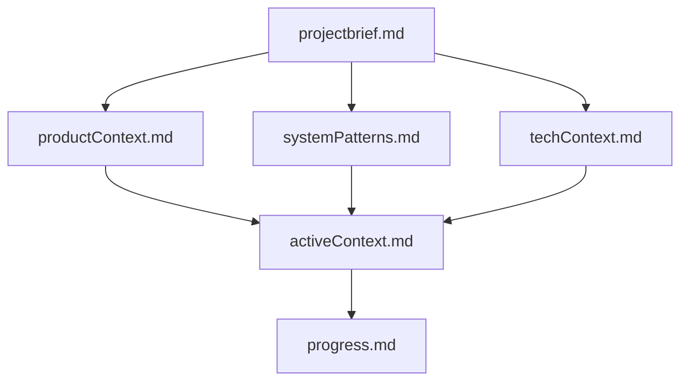

# Memory Bank - ContractGuard AI

## Overview

This Memory Bank contains comprehensive documentation for the ContractGuard AI project. It serves as the single source of truth for project context, technical decisions, and development progress.

## File Structure

### Core Files (Required Reading)

1. **`projectbrief.md`** - Foundation document with core requirements and goals
2. **`productContext.md`** - Business context, user experience, and market analysis
3. **`systemPatterns.md`** - Architecture patterns and technical decisions
4. **`techContext.md`** - Technologies, setup, and development environment
5. **`activeContext.md`** - Current work focus and immediate priorities
6. **`progress.md`** - Detailed progress tracking and status updates

### Supporting Files

- **`README.md`** - This file, Memory Bank navigation guide

## Usage Guidelines

### For New Sessions

1. **Always read ALL core files** at the start of any new session
2. **Start with `projectbrief.md`** to understand the foundation
3. **Review `activeContext.md`** for current priorities
4. **Check `progress.md`** for latest status updates

### For Development Work

1. **Reference `systemPatterns.md`** for architecture decisions
2. **Use `techContext.md`** for setup and configuration
3. **Update `activeContext.md`** when priorities change
4. **Update `progress.md`** after completing milestones

### For Project Understanding

1. **Read `productContext.md`** to understand business goals
2. **Review `systemPatterns.md`** for technical architecture
3. **Check `techContext.md`** for implementation details

## File Relationships

## Update Triggers

Update these files when:

- **`activeContext.md`**: Priorities change, new focus areas
- **`progress.md`**: Milestones completed, status changes
- **`systemPatterns.md`**: Architecture decisions made
- **`techContext.md`**: Technology stack changes
- **`productContext.md`**: Business requirements change
- **`projectbrief.md`**: Core goals or scope change

## Quick Reference

### Current Status

- **Project Phase**: MVP Development (65% complete)
- **Current Focus**: Fix critical gaps, prepare for production
- **Next Milestone**: Complete core MVP (Days 1-3)
- **Timeline**: 14-day MVP, launch in 2 weeks

### Key Metrics

- **Backend**: 80% complete
- **Frontend**: 85% complete
- **User Management**: 0% complete
- **Payment Integration**: 0% complete
- **Production Readiness**: 30% complete

### Critical Issues

1. AI Service error handling needs improvement
2. Rate limiting not implemented
3. User authentication system missing
4. Production deployment not configured

---

**Created**: 2024-12-19  
**Status**: Complete and ready for use  
**Next Review**: Daily during active development
